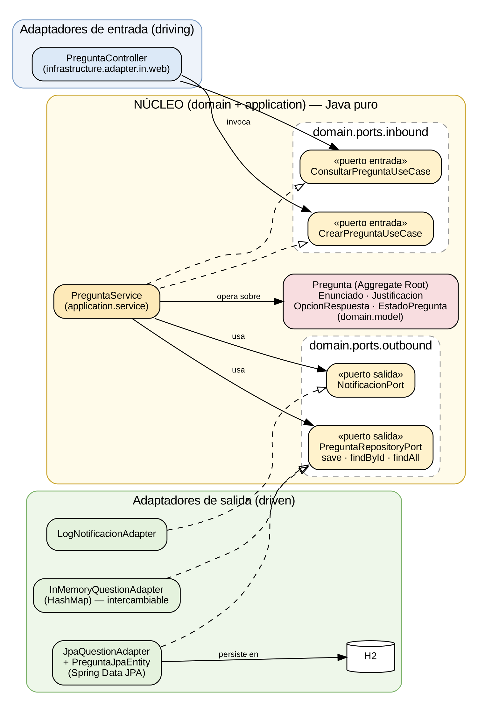

# Taller 12 – Arquitectura Hexagonal y DDD (Fase I) · Banco de Preguntas Saber PRO

Laboratorio de Ingeniería de Software II – Universidad del Cauca – 2026.2
Grupo 1: Joseph David Trujillo Gómez · Juan Pablo Hernández

Evolución del proyecto del Taller 11 (dominio DDD puro) hacia una **Arquitectura
Hexagonal (Puertos y Adaptadores)**, siguiendo el proyecto de referencia
`gymclass-ddd-hexagonal`. El dominio no cambió de reglas; ahora vive dentro de un
hexágono con puertos y adaptadores intercambiables.



## Estructura

```
src/main/java/co/edu/unicauca/saberpro/
├── domain/                      NÚCLEO · Java puro (sin Spring ni JPA)
│   ├── model/                   Pregunta (Aggregate Root), Enunciado, Justificacion,
│   │                            OpcionRespuesta (Value Objects), EstadoPregunta
│   ├── exception/               DomainException, ReglaNegocioException,
│   │                            PreguntaNoEncontradaException
│   └── ports/
│       ├── inbound/             CrearPreguntaUseCase, ConsultarPreguntaUseCase,
│       │                        CrearPreguntaCommand            (puertos de entrada)
│       └── outbound/            PreguntaRepositoryPort, NotificacionPort
│                                                                (puertos de salida)
├── application/service/         PreguntaService (implementa los puertos de entrada)
└── infrastructure/              ADAPTADORES y configuración (aquí viven los frameworks)
    ├── adapter/in/web/          PreguntaController, ApiExceptionHandler, dto/
    ├── adapter/out/persistence/ JpaQuestionAdapter, PreguntaJpaEntity,
    │                            SpringDataPreguntaRepository, mapper
    ├── adapter/out/memory/      InMemoryQuestionAdapter (HashMap)
    ├── adapter/out/notification/LogNotificacionAdapter
    └── config/                  HexagonalConfiguration (composition root)
```

**Regla de dependencias:** `infrastructure → application → domain`. El dominio no
importa nada de `application` ni de `infrastructure` (lo verifica `DominioPuroTest`).

## Ejecutar (Windows + Visual Studio Code)

Requisitos: JDK 17 o superior y Maven 3.8+ (verifica con `java -version` y `mvn -version`
en PowerShell). En VS Code instala **Extension Pack for Java** y **Spring Boot Extension Pack**.

Abre la carpeta `saberpro-ddd` en VS Code y, en la terminal integrada (PowerShell):

```powershell
mvn test               # dominio, aplicación, adaptadores y API
mvn spring-boot:run    # API con JpaQuestionAdapter + H2 (puerto 8080)
```

También puedes ejecutar `SaberproApplication` con el botón *Run* de VS Code, y las
pruebas desde el panel *Testing*.

H2 Console: `http://localhost:8080/h2-console` — JDBC URL `jdbc:h2:mem:saberprodb`, usuario `sa`, sin clave.

## API REST

| Método | Ruta | Descripción |
|---|---|---|
| POST | `/api/preguntas` | Crea una pregunta en BORRADOR |
| POST | `/api/preguntas/{id}/enviar-revision` | Valida invariantes → PENDIENTE_REVISION |
| GET | `/api/preguntas` | Lista las preguntas |
| GET | `/api/preguntas/{id}` | Consulta una pregunta |

```json
{
  "enunciado": "¿Qué patrón separa la lógica de negocio de la interfaz?",
  "justificacion": "MVC separa modelo, vista y controlador.",
  "opciones": [
    {"texto": "MVC", "esCorrecta": true},
    {"texto": "Singleton", "esCorrecta": false},
    {"texto": "Factory", "esCorrecta": false},
    {"texto": "Observer", "esCorrecta": false}
  ]
}
```

Una regla de negocio violada responde **400**; una pregunta inexistente, **404**.

## Prueba de intercambiabilidad (Pasos 1–3 del taller)

El adaptador activo se elige en un solo lugar, `HexagonalConfiguration`, con la
propiedad `saberpro.persistence.adapter` (`jpa` por defecto, o `memory`).
En PowerShell, los argumentos `-D` van entre comillas:

```powershell
# Paso 1: JpaQuestionAdapter (por defecto)
mvn spring-boot:run

# Paso 2: activar InMemoryQuestionAdapter SIN tocar el paquete domain
mvn spring-boot:run "-Dspring-boot.run.profiles=memory"
# (equivalente: mvn spring-boot:run "-Dspring-boot.run.arguments=--saberpro.persistence.adapter=memory")

# Paso 3: pruebas unitarias e integración con los dos adaptadores
mvn test
```

Para comprobar la API a mano (Thunder Client, Postman o `curl.exe`), repite las mismas
peticiones del apartado *API REST* con cada adaptador y compara las respuestas.

Opcional: `scripts/probar-intercambiabilidad.sh` automatiza esa comparación. Es un script
bash, así que en Windows se ejecuta desde **Git Bash** (incluido con Git for Windows):
`bash scripts/probar-intercambiabilidad.sh`.

La evidencia automática está en las pruebas:

- `InMemoryQuestionAdapterTest` y `JpaQuestionAdapterTest` heredan **la misma**
  `PreguntaRepositoryPortContractTest` (contrato del puerto).
- `PreguntaApiJpaTest` y `PreguntaApiMemoryTest` heredan **la misma**
  `PreguntaApiContractTest` (flujo REST de extremo a extremo).

## Invariantes del dominio

- Enunciado: no nulo ni vacío.
- Justificación: mínimo 15 caracteres (si no, `ReglaNegocioException`) y sin palabras prohibidas.
- Opción de respuesta: texto no vacío.
- Pregunta: máximo 4 opciones, sin textos repetidos, modificable solo en BORRADOR.
- Envío a revisión: exactamente 4 opciones y exactamente 1 clave; BORRADOR → PENDIENTE_REVISION.
- Ciclo de vida: solo transiciones permitidas entre estados.
